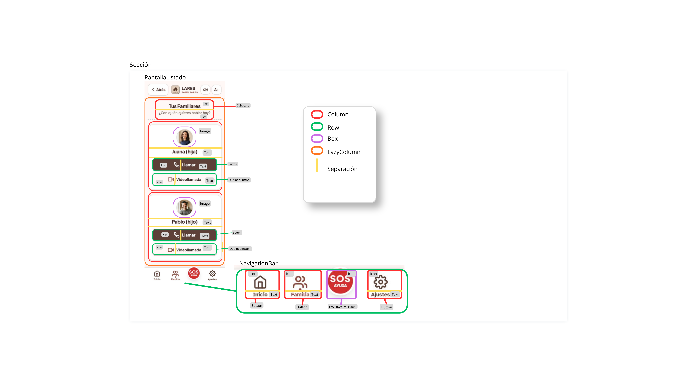

**DISEÑO DE ALTA FIDELIDAD DE LA PÁGINA DE LISTADO**
A continuación, se muestra la pantalla de listado en la que aparecen los familiares guardados en la 
aplicación.

**ANÁLISIS DE COMPONENTES**

Como se puede observar en el diseño, toda la pantalla se encuentra envuelta en un LazyColumn que distribuye
los elementos verticalmente y permite el desplazamiento por la pantalla (scroll).

### 1. Cabecera de la pantalla (Título y subtítulo)

-Layout principal: Column (distribución vertical). Actúa como cabecera de la pantalla.
- **Componentes interiores:**
    - Text: Título principal de la sección
    - Text: Subtítulo explicativo

### 2. Tarjeta Vertical de Familiar (Contacto 1 -Juana)

Ambas tarjetas de familiares son componenetes reutilizables porque repiten patrones.

-Layout principal: Column (distribución vertical de los elementos)
- **Componentes interiores:**
    - Box + Image: Contenedor circular para la foto de perfil del familiar
    - Text: Identificador del familiar y parentesco
    - Button + Row: Contenedor interactivo de llamada con un row, que distribuye los elementos horizontalmente.
      - Icon: teléfono
      - Text: Llamar
    - OutlinedButton + Row: Contenedor interactivo de videollamada con borde marrón. Incluye un row,
        que distribuye los elementos internos de manera horizontal.
        - Icon: cámara
        - Text: texto de la acción

### 3. Tarjeta Vertical de Familiar (Contacto 2 -Pablo)
-Layout principal: Column (distribución vertical de los elementos)
- **Componentes interiores:**
    - Box + Image: Contenedor circular para la foto de perfil del familiar
    - Text: Identificador del familiar y parentesco
    - Button + Row: Contenedor interactivo de llamada con un row, que distribuye los elementos horizontalmente.
        - Icon: teléfono
        - Text: Llamar
    - OutlinedButton + Row: Contenedor interactivo de videollamada con borde marrón. Incluye un row,
      que distribuye los elementos internos de manera horizontal.
        - Icon: cámara
        - Text: texto de la acción

### 4. Navigation Bar

Barra global fijada en la parte inferior,  que distribuye horizontalmente las secciones principales.

-Layout principal: Row (distribución horizontal)
- Column (Layouts Secundarios): Aparecen tres.
- **Componentes interiores:**
    - NavigationBarItem / Button: Tres accesos directos estándar (Inicio, Familia, Ajustes) que combinan Icon y Text.
    - FloatingActionButton + Box: Botón destacado central (Ayuda / SOS) con fondo rojo elevado, que
      combina Icon + Text.
  

**ÁRBOL DE COMPONENTES**

A continuación se muestran dos diseños del árbol, uno realizado en canva y otro, en figma. Se presentan
de esta manera debido a que canva no mostraba los niveles correctamente y se perfeccionaron en Figma.

