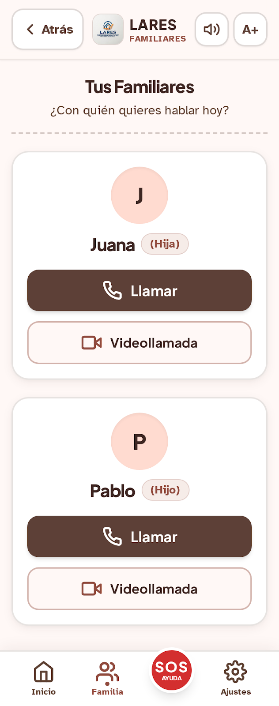
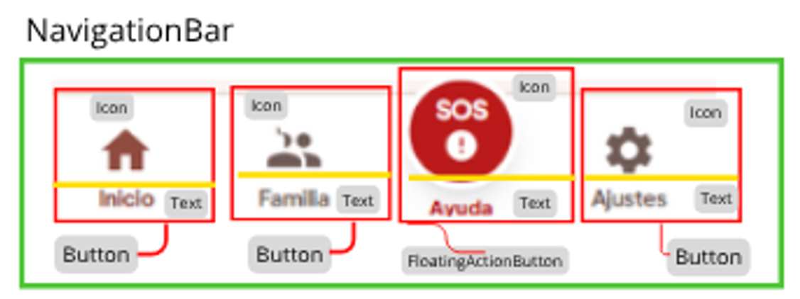

**DISEÑO DE ALTA FIDELIDAD DE LA PÁGINA DE LISTADO**
A continuación, se muestra la pantalla de listado en la que aparecen los familiares guardados en la 
aplicación.

**ANÁLISIS DE COMPONENTES**

**ÁRBOL DE COMPONENTES**

### 5. Navigation Bar

Barra global fijada en la parte inferior,  que distribuye horizontalmente las secciones principales.
-Layout principal: Row (distribución horizontal)
- Column (Layouts Secundarios): Aparecen cuatro.
- **Componentes Fundamentales:**
    - NavigationBarItem / Button: Tres accesos directos estándar (Inicio, Familia, Ajustes) que combinan Icon y Text.
    - FloatingActionButton / Box: Botón destacado central (Ayuda / SOS) con fondo rojo elevado, que
      combina Icon + Text.