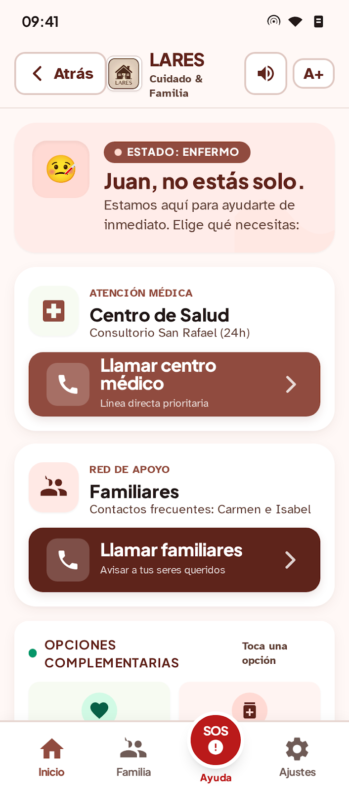
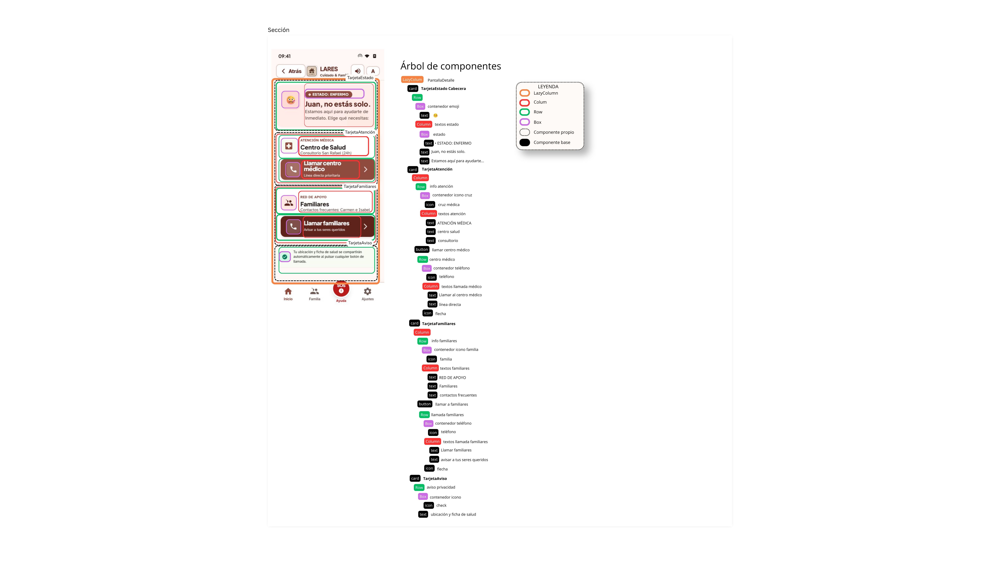

**DISEÑO DE ALTA FIDELIDAD DE LA PÁGINA DE DETALLE**

**ANÁLISIS DE COMPONENTES**
Dentro de la aplicación, se realizaron los mockups de cinco pantallas. A continuación se presenta el
análisis de la PáginaDetalle, que pertenece al mockup de la pantalla_estado_enfermo:

En ella, desglosamos el análisis en cinco componentes distintos que se describen a continuación:
Utilizaremos:
- Rectángulo rojo: column
- Rectángulo verde: row
- Rectángulo rosa: box
- Línea amarilla: separaciones

### 1. Tarjeta Horizontal (Cabecera de Estado)

- Layout principal: Row (distribución horizontal).
- **Componentes interiores:**
    - Box + Text: Ilustración a color del emoji.
    - Column: Apila verticalmente la insignia de estado y los textos correspondientes.
    - Box + Text: Contenedor marrón con el texto de estado.

### 2. Tarjeta Vertical de acción (Atención médica)

- Layout principal: Column (distribución vertical).
- **Componentes interiores:**
    - Row: Presenta dos row con información.
    - Box + Icon: Contenedores redondeados para la cruz médica y el teléfono.
    - Column: Que presenta text apilado en ambos contenedores.
    - Button: Contenedor interactivo para la llamada directa al centro médico.
    - Icon flecha.

### 3. Tarjeta Vertical de acción (Red de apoyo)

- Layout principal: Column (distribución vertical)
- **Componentes interiores:**
    - Row: Presenta dos row con información.
    - Box + Icon: Contenedores redondeados para familia y el teléfono.
    - Column: Que presenta text apilado en ambos contenedores.
    - Button: Contenedor interactivo para la llamada directa a familiares.
    - Icon flecha.

### 4. Tarjeta horizontal de aviso de privacidad

- Layout principal: Row (distribución horizontal)
- **Componentes interiores:**
    - Box + Icon: Cápsula verde con el icono de verificación
    - Text: Información acerca de la privacidad de los datos personales.

**ÁRBOL DE COMPONENTES**

A continuación se muestran dos diseños del árbol, uno realizado en canva y otro, en figma. Se presentan
de esta manera debido a que canva no mostraba los niveles correctamente y se perfeccionaron en Figma.

**CÓDIGO JETPACK COMPOSE**

